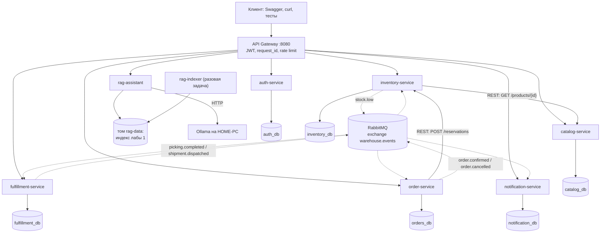

# Лабораторная 2. Складская система на микросервисах

## 1. Описание проекта

Backend складской системы: товары, ячейки и остатки, заказы с резервом товара, адресная и
волновая сборка (picking), отгрузки, уведомления, вход по ролям и ассистент по документации
Odoo (RAG из [лабораторной 1](../lab1/README.md)).

Система состоит из **7 бизнес-сервисов** и API Gateway. У каждого сервиса своя задача, свой
REST API со Swagger, своя база PostgreSQL, свои настройки из переменных окружения, JSON-логи
с `request_id`, `/health` и `/ready`. Сервисы общаются синхронно (REST) и асинхронно (события
через RabbitMQ).

Решения и их обоснование: [DECISIONS.md](DECISIONS.md).

## 2. Архитектура



Сплошная линия: синхронный запрос, отправитель ждёт ответ. Пунктир: событие через брокер,
отправитель не ждёт.

### Сервисы

| Сервис | Берёт | Делает | Получается | Зачем |
|---|---|---|---|---|
| **auth-service** | логин и пароль, данные пользователей от admin | хранит пользователей и роли (admin, manager, picker), проверяет пароль по bcrypt-хэшу, выдаёт JWT (RS256, 15 мин) и refresh-токен (7 дней) | таблицы `users`, `refresh_tokens` в `auth_db`; открытый ключ на `/auth/public-key` | остальные сервисы проверяют токен открытым ключом и не хранят паролей |
| **catalog-service** | карточки товаров | создание, поиск, поиск по штрихкоду, снятие с учёта | таблица `products` | единый справочник: остальные ссылаются на товар по id |
| **inventory-service** | приёмку, перемещения, запросы на резерв, события о сборке | учёт товара по ячейкам, резерв «всё или ничего» с блокировкой строк, списание после сборки | `locations`, `stock`, `reservations`, `movements`, `min_levels`; событие `stock.low` | единственное место, которое знает реальные остатки; не даёт продать больше, чем есть |
| **order-service** | заказ от менеджера | синхронно резервирует товар, сохраняет заказ, ведёт статусы confirmed → picked → shipped / cancelled | `orders`, `order_lines`, `order_status_history`; события `order.confirmed`, `order.cancelled` | точка входа бизнес-процесса |
| **fulfillment-service** | событие `order.confirmed` с ячейками из резерва; действия сборщика | задание на сборку с маршрутом по ячейкам, проверка отсканированной ячейки, недобор, волны со сводным маршрутом, отгрузки | `pickings`, `picking_lines`, `waves`, `shipments`; события `picking.completed`, `shipment.dispatched` | собственная логика складских процессов |
| **notification-service** | все события | превращает событие в уведомление для роли | таблица `notifications`, `GET /notifications` | пример асинхронности: при его падении остальные работают, события ждут в очереди |
| **rag-assistant** | вопрос пользователя | RAG лабы 1: разбор вопроса, гибридный поиск, reranker, ответ LLM со ссылками или отказ | ответ с источниками | подсказка «как сделать X в Odoo» |
| rag-indexer | репозиторий odoo/documentation | `grab → process → index` из лабы 1 | индекс в томе `rag-data` | индексация редкая и долгая, поэтому отдельная задача |
| gateway (не бизнес-сервис) | все запросы `/api/...` | проверка JWT, `X-Request-ID`, ограничение частоты, пересылка нужному сервису с таймаутом | одна точка входа | наружу открыт только он |

Общий служебный код (логи, ошибки, health/ready, JWT, события) лежит в пакете
[`libs/pad_common`](libs/pad_common). Бизнес-логики в нём нет.

### Главный сценарий

1. Менеджер создаёт заказ: `POST /api/orders`.
2. order-service синхронно вызывает inventory-service `POST /reservations` (таймаут 2 с).
   Не хватило товара → 409, заказ не создаётся. inventory не ответил → 503/504 и попытка
   снять резерв.
3. Заказ сохраняется вместе с событием `order.confirmed` в таблице outbox (одна транзакция).
   Фоновая задача отправляет событие в RabbitMQ.
4. fulfillment-service получает событие и создаёт задание на сборку с ячейками по порядку
   обхода. notification-service пишет уведомления сборщикам и менеджерам.
5. Сборщик берёт задание, сканирует ячейки, завершает сборку → `picking.completed`.
6. inventory списывает собранное (недобор возвращается в свободный остаток) и при остатке ниже
   минимума публикует `stock.low`. order ставит статус picked.
7. Менеджер отправляет отгрузку → `shipment.dispatched` → заказ shipped.

## 3. Используемые технологии

| Что | Выбор | Почему (подробно в DECISIONS.md) |
|---|---|---|
| Язык, фреймворк | Python 3.12, FastAPI | тот же стек, что в лабе 1; Swagger и проверка входных данных из коробки |
| База | PostgreSQL 16, своя база и пользователь на сервис | транзакции и блокировки строк для резерва |
| Работа с базой | SQLAlchemy 2 | таблицы описаны Python-классами |
| Брокер | RabbitMQ 3.13 (topic exchange, DLQ) | подтверждение обработки, повторы, веб-панель |
| Межсервисный REST | httpx с таймаутами | синхронные вызовы с понятными ошибками |
| Вход | JWT RS256 (PyJWT), bcrypt | закрытый ключ только у auth-service |
| Контейнеры | Docker, Docker Compose | вся система одной командой |
| Тесты | pytest, FastAPI TestClient, httpx MockTransport | unit, API и e2e |

## 4. Установка

Нужны Docker Desktop (Windows) и Python 3.11+ (только для скрипта `.env` и тестов).

```powershell
cd lab2
pip install cryptography          # для генерации ключа JWT
python scripts\init_env.py        # создаст lab2\.env со случайными паролями и ключом JWT
```

Скрипт печатает пароль администратора (`admin`). Файл `.env` в Git не попадает.

## 5. Запуск

```powershell
docker compose up --build -d
docker compose ps                  # все сервисы должны быть healthy
curl http://localhost:8080/api/status
```

* Gateway: http://localhost:8080
* Swagger каждого сервиса: http://localhost:8001/docs (auth) … 8006 (notification), 8007 (RAG)
* Панель RabbitMQ: http://localhost:15672 (логин и пароль из `.env`)

RAG-ассистенту нужна Ollama на HOME-PC. Перед запуском откройте туннель на этом компьютере:
`ssh -N -L 11434:localhost:11434 homepc`. Из контейнера он доступен как
`host.docker.internal:11434`. Без Ollama `/api/assistant/search` работает, а
`/api/assistant/ask` отвечает 503. Первый запуск `rag-indexer` скачивает документацию Odoo и
модель MiniLM (несколько минут).

Запустить только складскую часть без RAG:
`docker compose up -d postgres rabbitmq auth-service catalog-service inventory-service order-service fulfillment-service notification-service gateway`.

## 6. Configuration

Все настройки задаются переменными окружения (в лабе 3 они станут ConfigMap и Secret).

| Переменная | Где | Секрет | Что задаёт |
|---|---|---|---|
| `DATABASE_URL` | все, кроме gateway и RAG | да (пароль) | строка подключения к своей базе |
| `RABBITMQ_URL` | inventory, order, fulfillment, notification | да | адрес брокера; пусто = события выключены |
| `AUTH_PUBLIC_KEY_URL` | все сервисы, gateway | нет | откуда взять открытый ключ JWT |
| `JWT_PRIVATE_KEY` | auth | да | закрытый ключ RSA для подписи токенов |
| `ADMIN_PASSWORD` | auth | да | пароль первого администратора |
| `CATALOG_URL`, `INVENTORY_URL` | inventory, order | нет | адреса других сервисов |
| `HTTP_TIMEOUT` | все | нет | таймаут межсервисных запросов (2 с) |
| `RATE_LIMIT_PER_MINUTE` | gateway | нет | запросов в минуту на пользователя |
| `OLLAMA_URL`, `LLM_MODEL` | rag-assistant | нет | где LLM |
| `READY_REQUIRES_LLM` | rag-assistant | нет | false: без Ollama сервис готов, но помечен degraded |
| `LOG_LEVEL`, `LOG_FORMAT` | все | нет | уровень и формат логов (json) |

## 7. API

Все адреса снаружи идут через gateway с префиксом `/api`. Без токена доступны только вход,
обновление токена и открытый ключ.

| Метод и адрес | Роль | Что делает |
|---|---|---|
| `POST /api/auth/login` | — | логин и пароль → access и refresh токены |
| `POST /api/auth/refresh`, `POST /api/auth/logout` | — | обновить или отозвать refresh-токен |
| `GET /api/auth/me` | любая | текущий пользователь |
| `GET /api/users`, `POST /api/users`, `PATCH /api/users/{id}` | admin | пользователи и роли |
| `GET /api/products?q=`, `GET /api/products/{id}`, `GET /api/products/by-barcode/{code}` | любая | справочник товаров |
| `POST /api/products`, `PATCH`/`DELETE /api/products/{id}` | manager | изменить справочник |
| `GET /api/locations`, `POST /api/locations` | любая / manager | ячейки |
| `POST /api/stock/receipts` | manager | приёмка товара в ячейку |
| `POST /api/stock/moves` | manager, picker | перемещение между ячейками |
| `GET /api/stock`, `GET /api/stock/summary/{product_id}` | любая | остатки |
| `PUT /api/stock/min-levels/{product_id}` | manager | минимум для `stock.low` |
| `GET /api/movements` | любая | журнал движений |
| `POST /api/reservations`, `GET`/`DELETE /api/reservations/{order_id}` | manager | резерв (обычно вызывает order-service) |
| `POST /api/orders` | manager | создать заказ с резервом |
| `GET /api/orders`, `GET /api/orders/{id}` | любая | заказы, строки, история статусов |
| `POST /api/orders/{id}/cancel` | manager | отменить подтверждённый заказ |
| `GET /api/pickings`, `GET /api/pickings/{id}` | любая | задания на сборку |
| `POST /api/pickings/{id}/start` | picker | взять задание |
| `POST /api/pickings/{id}/lines/{line_id}/pick` | picker | отметить строку (код отсканированной ячейки + количество) |
| `POST /api/pickings/{id}/complete` | picker | завершить сборку |
| `POST /api/waves`, `GET /api/waves/{id}` | manager / любая | волна и сводный маршрут |
| `GET /api/shipments`, `POST /api/shipments/{id}/dispatch` | любая / manager | отгрузки |
| `GET /api/notifications`, `POST /api/notifications/{id}/read` | любая | уведомления для своих ролей |
| `POST /api/assistant/ask`, `POST /api/assistant/search` | любая | RAG-ассистент |
| `GET /api/status` | — | готовность всех сервисов |
| `GET /health`, `GET /ready` | — | у каждого сервиса и gateway |

Ошибки у всех сервисов в одном формате, без stack trace:

```json
{"error": {"code": "insufficient_stock", "message": "not enough stock for the order",
           "details": [{"product_id": 7, "requested": 9, "available": 2}]},
 "request_id": "aca2fcdba158"}
```

| Код | Когда |
|---|---|
| 401 `unauthorized`, `token_expired`, `invalid_token` | нет токена, истёк, подделан |
| 403 `forbidden` | не та роль |
| 404 `not_found` | нет ресурса |
| 409 `insufficient_stock`, `invalid_status`, `duplicate_*` | конфликт с текущим состоянием |
| 422 `invalid_request`, `wrong_location`, `over_pick` | неверные входные данные |
| 429 `rate_limited` | слишком часто |
| 503 `upstream_unavailable` | другой сервис или база недоступны |
| 504 `upstream_timeout` | другой сервис не ответил вовремя |

## 8. Примеры использования

PowerShell (в Windows `curl` в PowerShell — это `Invoke-WebRequest`, поэтому пример на
`Invoke-RestMethod`):

```powershell
$base = "http://localhost:8080/api"
$t = Invoke-RestMethod -Method Post "$base/auth/login" -ContentType "application/json" `
     -Body '{"username":"admin","password":"<ADMIN_PASSWORD из .env>"}'
$h = @{ Authorization = "Bearer $($t.access_token)" }

Invoke-RestMethod -Method Post "$base/products" -Headers $h -ContentType "application/json" `
  -Body '{"sku":"SKU-0001","name":"Коробка 40x30x20","barcode":"4601234567890"}'
Invoke-RestMethod -Method Post "$base/locations" -Headers $h -ContentType "application/json" -Body '{"code":"A-01-02-03","zone":"A"}'
Invoke-RestMethod -Method Post "$base/stock/receipts" -Headers $h -ContentType "application/json" `
  -Body '{"product_id":1,"location_code":"A-01-02-03","quantity":10}'
$o = Invoke-RestMethod -Method Post "$base/orders" -Headers $h -ContentType "application/json" `
  -Body '{"customer_name":"ООО Ромашка","shipping_address":"Кишинёв","lines":[{"product_id":1,"quantity":3}]}'
Invoke-RestMethod "$base/pickings?status=ready" -Headers $h      # задание уже создано событием
```

Удобнее всего пробовать через Swagger: http://localhost:8001/docs → `POST /auth/login` →
скопировать `access_token` → кнопка **Authorize** в Swagger любого сервиса.

## 9. Тестирование

| Уровень | Что проверяет | Где | Как запустить |
|---|---|---|---|
| unit + API | логика и эндпоинты каждого сервиса на SQLite в памяти; другие сервисы подменены (`httpx.MockTransport`), события подаются напрямую в обработчики | `*/tests/` | `python scripts\run_tests.py` |
| e2e | вся система в Docker через gateway: заказ → сборка → списание → уведомления → отгрузка; отмена; 10 одновременных заказов; формат ошибок; `request_id` | `tests/e2e/` | см. ниже |
| отказы | остановка notification, inventory, RabbitMQ и восстановление | `scripts/demo_failures.py` | `python scripts\demo_failures.py` |

```powershell
pip install -e libs\pad_common; pip install bcrypt pytest
python scripts\run_tests.py
$env:E2E_BASE_URL="http://localhost:8080"; $env:E2E_ADMIN_PASSWORD="<из .env>"
python -m pytest tests\e2e -v
```

Результат последнего прогона (5 ноября 2026, Docker, PostgreSQL 16, RabbitMQ 3.13):
49 unit/API-тестов и 5 e2e-тестов проходят.

## 10. Результаты экспериментов

**Одновременные заказы.** На товар с остатком 5 штук (в двух ячейках) одновременно
отправлено 10 заказов по 1 штуке. Результат: ровно 5 ответов 201 и 5 ответов 409,
`reserved = 5`, `available = 0`. Перепродажи нет благодаря блокировке строк остатка
(`SELECT ... FOR UPDATE`) в одной транзакции.

**Отказы** (`scripts/demo_failures.py`):

| Упал | Во время отказа | После восстановления |
|---|---|---|
| notification-service | заказ 201; `GET /notifications` 503; в очереди RabbitMQ 1 сообщение | уведомление пришло после запуска |
| inventory-service | заказ 503 `upstream_unavailable` | заказ не создан, товар не завис |
| RabbitMQ | заказ 201 (событие сохранено в outbox) | задание на сборку появилось после запуска брокера |

**Сквозной `request_id`.** Один запрос `POST /api/orders` оставил строки с одинаковым
`request_id` в логах gateway, order, inventory, fulfillment и notification (событие несёт
`request_id` дальше): `docker compose logs | findstr <request_id>`.

## 11. Выводы

* 7 сервисов с отдельными базами и API, взаимодействие синхронное (резерв) и асинхронное
  (6 типов событий).
* Резерв «всё или ничего» в одной транзакции inventory-service защищает от перепродажи даже
  при одновременных заказах; это причина держать ячейки, остатки и резервы в одном сервисе.
* Outbox и идемпотентные обработчики дают доставку событий «хотя бы один раз» без потерь при
  падении брокера и без двойной обработки.
* Падение одного сервиса не роняет остальные: проверено опытом для notification, inventory и
  RabbitMQ.
* Ограничения и следующие шаги перечислены в [DECISIONS.md](DECISIONS.md), раздел
  «Что не сделано».
