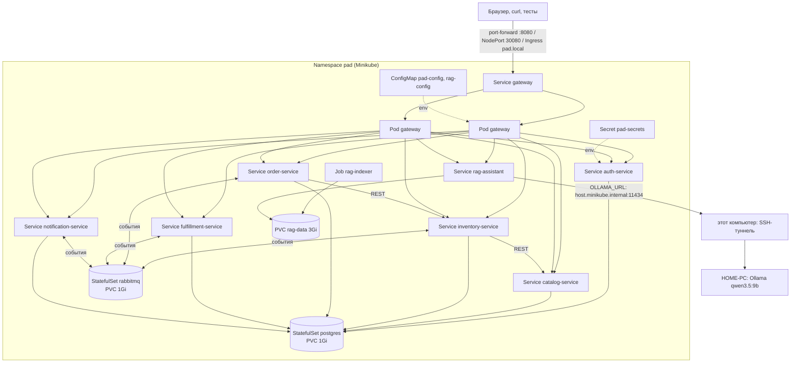

# Лабораторная 3. Docker и Kubernetes (Minikube) для складской системы

## 1. Описание проекта

Лаба 3 берёт приложение лабы 2 (7 бизнес-сервисов + API Gateway + RAG-ассистент из лабы 1,
PostgreSQL, RabbitMQ), упаковывает каждый сервис в Docker-образ и разворачивает всю систему в
Kubernetes на Minikube.

Что входит:
* **Docker:** Dockerfile на каждый сервис, `.dockerignore` на каждый Dockerfile, теги версий,
  запуск не от root. Описание и замеры: [docker/README.md](docker/README.md).
* **Docker Compose:** вся система одной командой `docker compose up --build` в `lab2/`
  (проверка перед Kubernetes).
* **Kubernetes:** манифесты в [k8s/](k8s): Namespace, 8 Deployment, 10 Service, 3 ConfigMap,
  Secret из файла вне Git, StatefulSet для PostgreSQL и RabbitMQ, Job для индексации RAG, PVC,
  Ingress, HPA (дополнительно). У каждого сервиса startup/liveness/readiness-пробы и
  requests/limits.
* **Скрипты:** сборка образов в Minikube, развёртывание, сценарий демонстрации ([scripts/](scripts)).
* **Решения и эксперименты для защиты:** [DECISIONS.md](DECISIONS.md).

Термины:
* **Docker** — программа, которая запускает приложения в контейнерах: изолированных процессах
  со своей файловой системой из образа. **Образ** — архив «Python + библиотеки + код + команда
  запуска».
* **Kubernetes** — система, которая запускает контейнеры, держит нужное число копий,
  перезапускает упавшие и даёт им постоянные адреса. **Minikube** — Kubernetes из одного узла на
  своём компьютере.
* **Pod** — одна запущенная копия сервиса (контейнер + IP-адрес).

## 2. Архитектура



| Объект Kubernetes | Сколько | Зачем |
|---|---|---|
| Namespace `pad` | 1 | всё приложение отдельно от системных объектов; удаляется одной командой |
| Deployment | 8 | auth, catalog, inventory, order, fulfillment, notification, gateway, rag-assistant: образ, число копий, переменные, пробы, ресурсы |
| Service | 10 | постоянное имя для каждого сервиса + postgres + rabbitmq; gateway типа NodePort |
| StatefulSet + PVC | 2 | PostgreSQL и RabbitMQ: постоянное имя Pod-а и свой диск |
| ConfigMap | 3 | `pad-config` (адреса, логи, таймауты), `rag-config` (Ollama), `postgres-init` (скрипт создания баз) |
| Secret | 1 | `pad-secrets`: пароли баз, RabbitMQ, администратора, ключ JWT (создаётся из файла вне Git) |
| Job | 1 | `rag-indexer`: разово строит индекс документации Odoo |
| PVC | 1 (+2 у StatefulSet) | `rag-data`: индекс RAG |
| Ingress | 1 | вход по `http://pad.local` через ingress-nginx |
| HPA (extras) | 1 | автоматическое масштабирование order-service по CPU, включается отдельно |

Копии: gateway, order-service, inventory-service по 2, остальные по 1 (почему — DECISIONS, раздел 8).

## 3. Используемые технологии

| Что | Выбор | Почему (подробно в DECISIONS.md) |
|---|---|---|
| Контейнеры | Docker, образы `python:3.12-slim` | маленькая база с glibc, все библиотеки ставятся без компиляции |
| Локальная проверка | Docker Compose (`lab2/docker-compose.yml`) | вся система одной командой до Kubernetes |
| Оркестрация | Kubernetes в Minikube | требование лабы; один узел на ПК |
| Сборка манифестов | kustomize (встроен в kubectl) | подпапки, общий namespace и Secret из файла вне Git одной командой |
| База и брокер | PostgreSQL 16, RabbitMQ 3.13 как StatefulSet | постоянные тома и имена |
| Вход снаружи | port-forward, NodePort, Ingress (ingress-nginx) | port-forward работает всегда, Ingress — как в настоящем кластере |
| Автомасштабирование | HPA + metrics-server (дополнительно) | показать масштабирование по нагрузке |

## 4. Установка (Windows, один раз)

Нужны: Docker Desktop (уже есть с лабы 2), Python 3.11+, Minikube и kubectl.

1. Установить Minikube и kubectl. В PowerShell **от имени администратора**
   (Пуск → набрать «PowerShell» → правой кнопкой → «Запуск от имени администратора»):
   ```powershell
   winget install Kubernetes.minikube
   winget install Kubernetes.kubectl
   ```
   Закрыть и открыть PowerShell заново (обычный, не администратор), проверить:
   ```powershell
   minikube version
   kubectl version --client
   ```
2. Запустить Docker Desktop (значок кита в трее должен стать неподвижным).
3. Запустить Minikube на Docker (4 ядра и 6 ГБ памяти: столько нужно 13 Pod-ам приложения и
   системным Pod-ам Kubernetes, расчёт в DECISIONS, раздел 7):
   ```powershell
   minikube start --driver=docker --cpus=4 --memory=6g
   kubectl get nodes          # должен быть один узел minikube со статусом Ready
   ```
   Если Docker Desktop даёт меньше 6 ГБ: Docker Desktop → Settings → Resources → Memory.
4. Пароли (если ещё не созданы в лабе 2):
   ```powershell
   cd C:\Users\CCCP\Desktop\4_Курс\PAD\pad-labs
   pip install cryptography
   python lab2\scripts\init_env.py          # создаст lab2\.env со случайными паролями и ключом JWT
   ```
   Если `lab2\.env` уже есть, но в нём пустой `JWT_PRIVATE_KEY=`, выполнить
   `python lab2\scripts\init_env.py --force` (пароли поменяются: тогда в лабе 2 нужен
   `docker compose down -v`, чтобы база создалась заново).

## 5. Запуск

Все команды из корня репозитория (`C:\Users\CCCP\Desktop\4_Курс\PAD\pad-labs`).

### Шаг 0. Проверка в Docker Compose (по требованиям — до Kubernetes)
```powershell
cd lab2
docker compose up --build -d
docker compose ps                         # все сервисы healthy
curl.exe http://localhost:8080/api/status
docker compose down                       # остановить перед Minikube, чтобы не делить память
cd ..
```

### Шаг 1. Собрать образы внутри Minikube
```powershell
powershell -ExecutionPolicy Bypass -File lab3\scripts\build-images.ps1
```
Скрипт переключает `docker` на Docker внутри Minikube и собирает 8 образов `pad/*:1.0.0` через
`lab2/docker-compose.yml`. В конце печатает список образов: должно быть 8 строк `pad/...`.
Если сборка внутри Minikube не идёт: `... build-images.ps1 -Mode load` (собрать в Docker Desktop
и скопировать в Minikube, дольше).

### Шаг 2. Развернуть
```powershell
powershell -ExecutionPolicy Bypass -File lab3\scripts\deploy.ps1
```
Скрипт создаёт `lab3\k8s\secrets\secrets.env` из `lab2\.env`, выполняет
`kubectl apply -k lab3\k8s` и ждёт готовности. То же вручную:
```powershell
python lab3\scripts\make_secrets.py
kubectl apply -k lab3\k8s
kubectl -n pad get pods -w                # Ctrl+C, когда все 1/1 Running
```

### Шаг 3. Дождаться индекса RAG
```powershell
kubectl -n pad logs -f job/rag-indexer      # скачивание документации, обработка, индекс (несколько минут)
kubectl -n pad get job rag-indexer          # COMPLETIONS 1/1
kubectl -n pad get pod -l app.kubernetes.io/name=rag-assistant   # 1/1 Running
```
Пока индекса нет, Pod `rag-assistant` в статусе `Init:0/1`: его initContainer ждёт метку
`/data/.index-ready`. Это нормально.

### Шаг 4. Открыть gateway
В **отдельном** окне PowerShell (держать открытым):
```powershell
kubectl -n pad port-forward svc/gateway 8080:8000
```
В основном окне:
```powershell
curl.exe http://localhost:8080/api/status      # "all_ready": true
```
Swagger gateway: http://localhost:8080/docs. Swagger отдельного сервиса:
`kubectl -n pad port-forward svc/order-service 8004:8000` → http://localhost:8004/docs.
Панель RabbitMQ: `kubectl -n pad port-forward svc/rabbitmq 15672` → http://localhost:15672.

### Шаг 5. Ollama для ассистента
Ассистенту нужна LLM на HOME-PC. На этом компьютере открыть SSH-туннель так, чтобы он
принимал подключения не только с 127.0.0.1 (Pod приходит с адреса Docker):
```powershell
ssh -N -L 0.0.0.0:11434:localhost:11434 homepc
```
Проверить из кластера:
```powershell
kubectl -n pad exec deploy/rag-assistant -- python -c "import urllib.request; print(urllib.request.urlopen('http://host.minikube.internal:11434/api/tags', timeout=5).read()[:200])"
```
Если ошибка: в `lab3\k8s\configmaps\rag-config.yaml` поставить в `OLLAMA_URL` адрес HOME-PC в
локальной сети (на HOME-PC Ollama должна слушать все адреса: переменная `OLLAMA_HOST=0.0.0.0`),
затем `kubectl apply -k lab3\k8s` и `kubectl -n pad rollout restart deployment rag-assistant`.
Без Ollama всё остальное работает, `/api/assistant/search` тоже; `/api/assistant/ask` отвечает 503.

### Шаг 6 (дополнительно). Ingress
```powershell
minikube addons enable ingress
kubectl -n ingress-nginx get pods          # ingress-nginx-controller 1/1 Running
minikube tunnel                            # в отдельном окне PowerShell от администратора, держать открытым
```
В файл `C:\Windows\System32\drivers\etc\hosts` (Блокнот от администратора → Файл → Открыть)
добавить строку `127.0.0.1 pad.local`, сохранить. Проверка: `curl.exe http://pad.local/api/status`.

### Шаг 7 (дополнительно). Автомасштабирование
```powershell
minikube addons enable metrics-server
kubectl apply -f lab3\k8s\extras\order-service-hpa.yaml
kubectl -n pad get hpa -w                  # TARGETS: cpu x%/70%, через минуту появятся числа
kubectl -n pad top pods                    # сколько CPU и памяти реально у каждого Pod-а
```
Выключить: `kubectl -n pad delete hpa order-service`.

### Остановить и удалить
```powershell
kubectl delete namespace pad      # удалить всё приложение вместе с данными (PVC)
minikube stop                     # остановить Minikube, всё сохранится до следующего minikube start
```

## 6. Конфигурация

Все настройки — переменные окружения. В Kubernetes несекретные приходят из ConfigMap, секретные
из Secret.

| Где | Ключ | Пример | Что задаёт |
|---|---|---|---|
| ConfigMap `pad-config` | `LOG_LEVEL`, `LOG_FORMAT` | `INFO`, `json` | уровень и формат логов |
| | `DATABASE_HOST`, `DATABASE_PORT` | `postgres`, `5432` | адрес PostgreSQL (имя Service) |
| | `RABBITMQ_HOST`, `RABBITMQ_PORT` | `rabbitmq`, `5672` | адрес RabbitMQ |
| | `AUTH_URL` … `RAG_URL`, `CATALOG_URL`, `INVENTORY_URL` | `http://order-service:8000` | адреса сервисов для gateway и межсервисных вызовов |
| | `AUTH_PUBLIC_KEY_URL` | `http://auth-service:8000/auth/public-key` | откуда брать открытый ключ JWT |
| | `HTTP_TIMEOUT`, `RATE_LIMIT_PER_MINUTE` | `2.0`, `300` | таймаут межсервисных запросов, лимит gateway |
| ConfigMap `rag-config` | `OLLAMA_URL`, `LLM_MODEL` | `http://host.minikube.internal:11434`, `qwen3.5:9b` | где LLM |
| | `READY_REQUIRES_LLM`, `DATA_DIR` | `false`, `/data` | готовность без LLM; папка тома |
| Secret `pad-secrets` | `*_DB_PASSWORD`, `POSTGRES_PASSWORD` | — | пароли баз |
| | `RABBITMQ_USER`, `RABBITMQ_PASSWORD` | — | вход в RabbitMQ |
| | `ADMIN_PASSWORD`, `JWT_PRIVATE_KEY` | — | первый администратор, ключ подписи токенов |

В Deployment строки подключения собираются из обоих источников:
`DATABASE_URL=postgresql+psycopg://orders:$(DB_PASSWORD)@$(DATABASE_HOST):$(DATABASE_PORT)/orders_db`.

Поменять настройку: `kubectl -n pad edit configmap pad-config` →
`kubectl -n pad rollout restart deployment`. Поменять пароль: `lab2\.env` →
`python lab3\scripts\make_secrets.py --force` → `kubectl apply -k lab3\k8s` → `rollout restart`
(пароли баз задаются только при первом запуске PostgreSQL; для смены пароля базы проще удалить
namespace и развернуть заново).

## 7. API

API то же, что в лабе 2 (таблица всех адресов: [lab2/README.md, раздел 7](../lab2/README.md#7-api)).
Снаружи доступен только gateway (`/api/...`); остальные сервисы — ClusterIP, видны только внутри
кластера. Служебные адреса каждого сервиса, которые использует Kubernetes:

| Адрес | Проба | Ответ |
|---|---|---|
| `GET /health` | startupProbe, livenessProbe | `200 {"status":"ok"}`, пока процесс жив |
| `GET /ready` | readinessProbe | `200 ready` / `200 degraded` (нет RabbitMQ, события ждут в outbox) / `503 not_ready` (нет базы) |
| `GET /api/status` (gateway) | — | готовность всех сервисов одним ответом, для демонстрации |

## 8. Примеры использования

Демонстрация для защиты по шагам (раздел 14 требований), с паузой перед каждым шагом:
```powershell
powershell -ExecutionPolicy Bypass -File lab3\scripts\demo.ps1
```
Что она показывает и какие команды можно набрать руками:

| Шаг | Команда | Что увидеть |
|---|---|---|
| 1. Pod-ы | `kubectl -n pad get pods -o wide` | 13 Pod-ов `1/1 Running` + `rag-indexer-...` `Completed` |
| 2. Service-ы | `kubectl -n pad get services` | 10 Service, у gateway `NodePort 8000:30080` |
| 3. Deployment-ы | `kubectl -n pad get deployments` | `READY 2/2` у gateway, order, inventory |
| 4. Логи | `kubectl -n pad logs deployment/order-service --tail=10` | JSON-строки с `service`, `level`, `request_id` |
| 5. Запросы | вход, создание товара, поиск, ассистент через `http://localhost:8080/api` | 200/201 |
| 6. Масштабирование | `kubectl -n pad scale deployment order-service --replicas=3` | 3 Pod-а, `kubectl -n pad get endpoints order-service` — 3 адреса |
| 7. Восстановление | `kubectl -n pad delete pod <имя Pod-а catalog-service>` | через несколько секунд новый Pod с другим именем `Running` |

Ещё сценарии:
```powershell
# Полный бизнес-сценарий лабы 2 (заказ -> сборка -> отгрузка) против кластера
$env:E2E_BASE_URL = "http://localhost:8080"
$env:E2E_ADMIN_PASSWORD = (Select-String -Path lab3\k8s\secrets\secrets.env -Pattern '^ADMIN_PASSWORD=(.*)').Matches[0].Groups[1].Value
cd lab2; python -m pytest tests/e2e -v; cd ..

# Отказ брокера: сервисы остаются в Service со статусом degraded, заказы принимаются
kubectl -n pad scale statefulset rabbitmq --replicas=0
kubectl -n pad exec deploy/order-service -- python -c "import urllib.request; print(urllib.request.urlopen('http://127.0.0.1:8000/ready').read())"
kubectl -n pad scale statefulset rabbitmq --replicas=1

# Обновление без простоя и откат
kubectl -n pad rollout restart deployment order-service
kubectl -n pad rollout status deployment order-service
kubectl -n pad rollout history deployment order-service
kubectl -n pad rollout undo deployment order-service

# Что внутри: переменные окружения Pod-а (видно, что пришло из ConfigMap и Secret)
kubectl -n pad describe pod -l app.kubernetes.io/name=order-service
kubectl -n pad describe secret pad-secrets      # ключи без значений
```

## 9. Тестирование

| Что | Как | Результат (2026-11-07) |
|---|---|---|
| unit- и API-тесты сервисов | `cd lab2; python scripts\run_tests.py` | 50 passed |
| e2e в docker compose | `docker compose up`, `pytest tests/e2e` | 5 passed |
| e2e в Kubernetes | port-forward/NodePort, `pytest tests/e2e` | 5 passed |
| манифесты | `kubectl apply -k` в тестовом кластере k3s v1.31 | 28 объектов, все Pod-ы Ready ~30 с |
| устойчивость | масштабирование, удаление Pod-ов, остановка RabbitMQ и PostgreSQL, обновление под нагрузкой | см. раздел 10 |

Как проверялось в облаке и что нужно досмотреть на ПК: [DECISIONS.md, раздел 13](DECISIONS.md#13-как-проверялось-и-что-осталось-проверить-на-пк).

## 10. Результаты экспериментов

| Эксперимент | Результат | Вывод |
|---|---|---|
| Повторная сборка образа после правки кода сервиса | 0,5 с, 5 слоёв из кэша; после правки *другого* сервиса — 0,36 с, всё из кэша | порядок слоёв и `.dockerignore` на сервис работают |
| Размер образа сервиса | 302 МБ на диске / 71 МБ сжатый; 276 МБ из них общие для всех 7 образов | slim-база без компиляторов |
| Память в простое | gateway 50 МБ, сервисы 72–85 МБ, PostgreSQL 78, RabbitMQ 144 | requests 128Mi / limits 256Mi с запасом |
| Удаление Pod-а catalog-service | новый Pod Running через 3 с | Deployment восстанавливает копии |
| Удаление Pod-а postgres-0 | данные на месте, e2e 5/5 | StatefulSet + PVC сохраняют данные |
| Масштабирование order-service 2 → 3 | 3 адреса в Service, e2e 5/5 | сервисы без состояния, копии взаимозаменяемы |
| Остановка RabbitMQ (до исправления) | `/ready` врал «connected» | найдена ошибка проверки в лабе 2 |
| Остановка RabbitMQ (после исправления) | сервисы `degraded`, но в Service; заказ, созданный без брокера, получил задание на сборку после его возврата | outbox + мягкая readiness = система не падает из-за брокера |
| Обновление gateway и order-service под запросами | без preStop 158/160 ответов 200; с preStop 5 с — 200/200 | обновление без потери запросов |
| 1000 запросов одного пользователя, лимит 300/мин | 1 копия gateway — 314 пропущено; 2 копии — 629 | лимит считается в каждой копии отдельно (известное ограничение) |
| RAG в кластере | initContainer дождался индекса (938 chunks), загрузка 0,55 с, поиск через gateway работает | индексатор и ассистент разделены, порядок старта соблюдён |

Подробно, с альтернативами: [DECISIONS.md](DECISIONS.md).

## 11. Выводы

* Каждый из 8 сервисов собирается в свой небольшой образ, запускается не от root и не содержит
  секретов; одна правка кода пересобирает за полсекунды только один образ.
* Система поднимается одной командой и в Docker Compose, и в Kubernetes; образы и переменные
  окружения одни и те же, отличается только способ их доставки (`.env` против ConfigMap и Secret).
* Kubernetes сам восстанавливает удалённые Pod-ы, держит заданное число копий, убирает
  неготовые копии из Service и обновляет сервисы без потери запросов.
* Проверка в кластере нашла две вещи, которые не видны в docker compose: неверную проверку
  соединения с RabbitMQ в `/ready` (исправлено) и лимит запросов, который при нескольких копиях
  gateway умножается на их число (записано как ограничение, решение — общий счётчик в Redis).
* Что можно сделать дальше: NetworkPolicy (запретить сервисам обращаться к чужим базам на
  уровне сети; в Minikube нужен `--cni=calico`), отдельный PostgreSQL на сервис, Helm-чарт для
  нескольких сред, сбор логов и метрик (Loki, Prometheus).

## Вопросы на защите (коротко)

**Docker или виртуальная машина?** Виртуальная машина запускает целую операционную систему со
своим ядром (гигабайты, минуты на старт). Контейнер использует ядро хоста и изолирует только
процесс и его файлы (десятки-сотни МБ, старт за секунды). Поэтому 13 контейнеров приложения помещаются
в Minikube с 6 ГБ памяти.

**Зачем Kubernetes, если есть docker compose?** Compose запускает контейнеры на одном
компьютере и только перезапускает упавшие. Kubernetes держит нужное число копий, делит между ними
запросы, не пускает трафик в неготовые копии, обновляет без простоя, откатывает версии и
масштабируется на много компьютеров.

**Что делает Deployment?** Описывает, какой образ запускать и сколько копий держать. Через
ReplicaSet следит, чтобы копий было ровно столько, и при обновлении заменяет их по одной.

**Что делает Service?** Даёт постоянное имя и адрес группе Pod-ов (по меткам) и делит запросы
между готовыми. Pod-ы меняют IP, имя Service — нет.

**ConfigMap и Secret?** Настройки вне образа. ConfigMap — обычные (адреса, логи), Secret —
пароли и ключи. Secret не в Git, Pod получает только свои ключи. base64 в Secret — не
шифрование.

**Что будет, если удалить Pod?** Deployment увидит, что копий меньше, чем нужно, и сразу создаст
новый Pod (на демонстрации — за 3 с). Пока новый не готов, запросы идут в остальные копии. У
PostgreSQL данные на PVC, новый Pod подключает тот же диск.

**Как Kubernetes понимает, что сервис здоров?** По пробам: livenessProbe на `/health` (не
отвечает 3 раза — перезапуск), readinessProbe на `/ready` (база недоступна — Pod временно
убирается из Service), startupProbe — даёт время на старт.

**Что будет, если упадёт один сервис?** Его копии перезапустятся. Пока он недоступен: gateway
отвечает 503 на запросы к нему; order-service при недоступном inventory не создаёт заказ (503);
если упал notification-service, события ждут в его очереди RabbitMQ и обработаются после
перезапуска. Если упал RabbitMQ — заказы принимаются, события ждут в outbox.

**Как масштабируется?** Вручную `kubectl scale`, автоматически HPA по CPU. Сервисы не хранят
состояния в памяти, поэтому копии взаимозаменяемы; события не обрабатываются дважды благодаря
общей очереди и `processed_events`.
